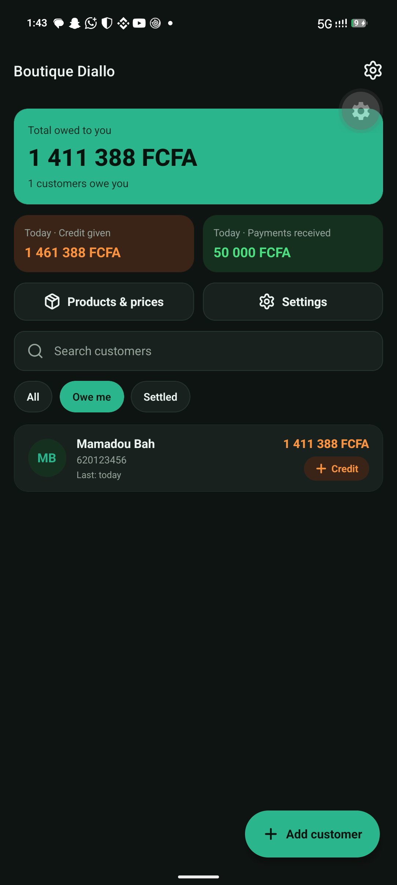
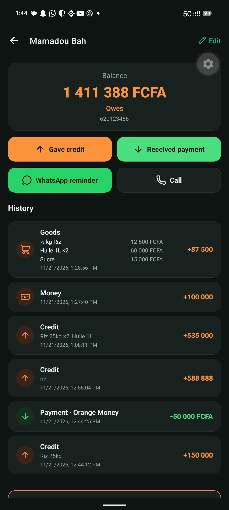
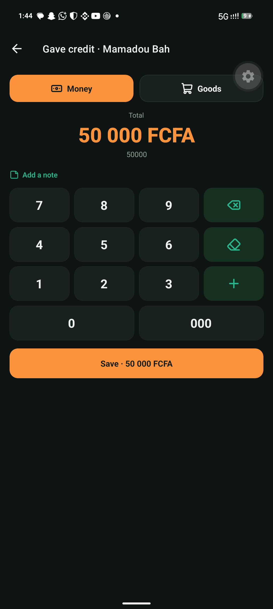
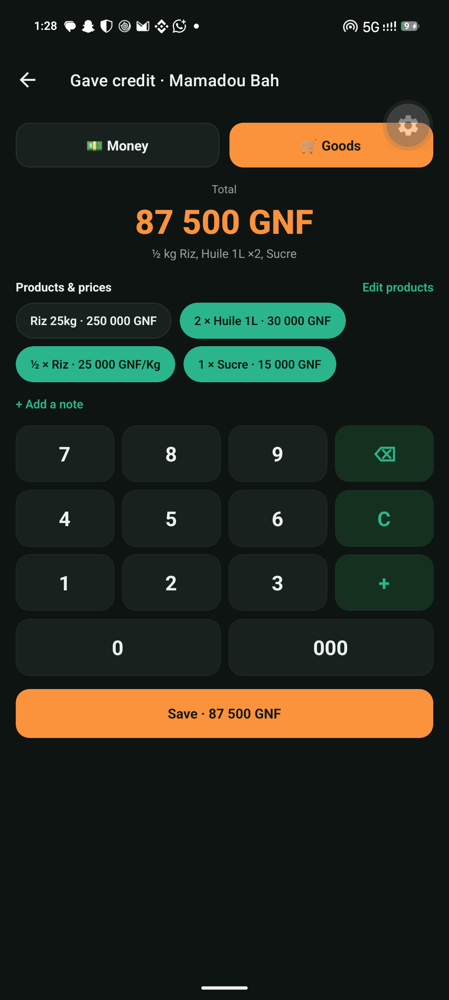
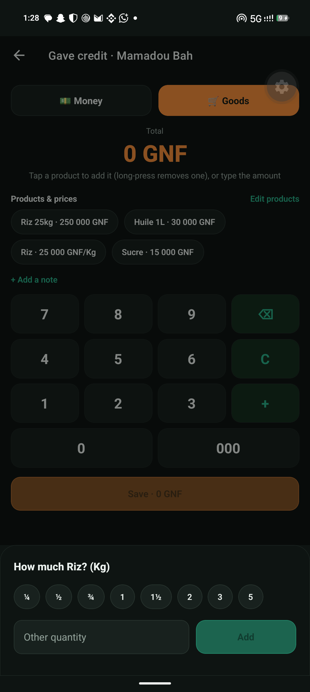
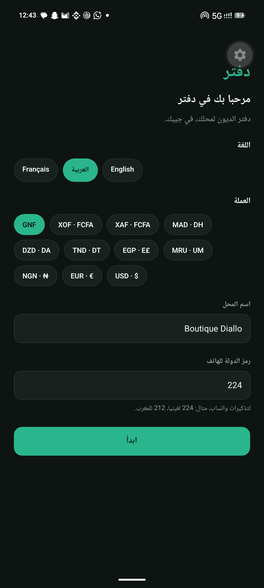
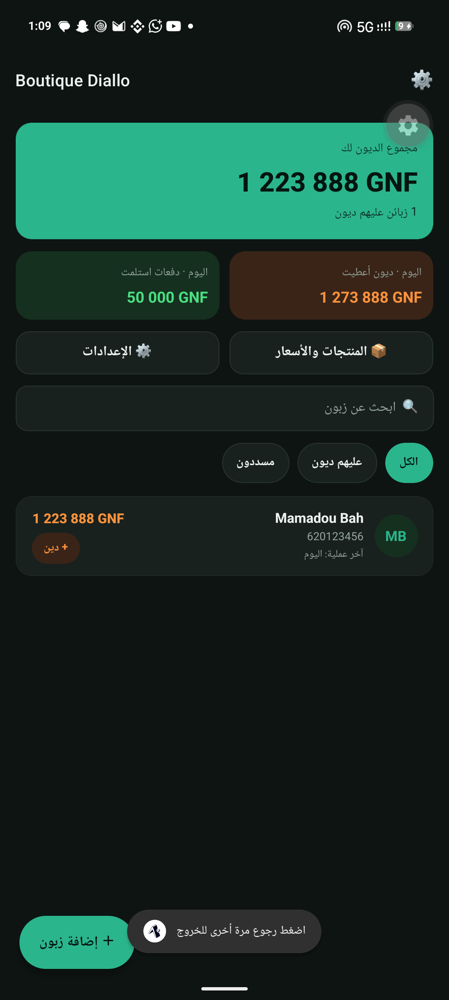
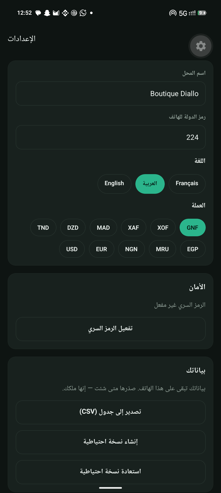

# Daftar — the shop credit notebook, in your pocket

> **I'd love your honest feedback.** This page explains what the app does today, which problems it tries to
> solve, and what we plan next. The questions at the end are the ones that matter most to us.
> The visual design is temporary — it will be redone; please focus on **what the app does**.

---

## 1. The problem

In corner shops across West Africa and the Arab world, selling on credit is a daily habit. The shopkeeper
writes debts in a paper notebook — the *crédit cahier* / *karni* / *دفتر الديون*. It works, but:

- **The notebook gets lost, torn or wet** — and the money with it.
- **Disputes:** "I never took that" — there is no proof both sides agree on.
- **Forgetting:** who promised to pay when? Small debts quietly become losses.
- **Slow at the counter:** writing items and adding them up while other customers wait.
- **Awkwardness:** asking a neighbour or a friend for money is uncomfortable.

Mobile money (Wave, Orange Money, MTN MoMo) is everywhere, but the credit book is still paper. The apps that
tried (Kippa, Khatabook-style apps) either left the region, pivoted to lending, or are not made for French
and Arabic speakers who often work offline.

## 2. Who it is for

Owners of small shops — groceries, boutiques, market stalls — in Guinea, Senegal, Mali, Côte d'Ivoire,
Morocco and similar markets. Often one person, one Android phone, unstable internet, French or Arabic.

## 3. What Daftar does today

| Problem | What the app does |
|---|---|
| Notebook lost / no copy | Everything is stored on the phone, **works with no internet**. Export to a spreadsheet (CSV) and a full **backup file** that can be restored. No account, no server. |
| "Who owes me what?" | Home screen: **total owed**, how many customers owe, today's credit and payments; customer list sorted by who owes most; search; filters *All / Owe me / Settled*. |
| Knowing the person | Add a customer **from phone contacts**, with a **description** ("tailor, street 10, cousin of Ali"); each row shows the **last activity**. |
| Cash loans vs goods | Two kinds of credit: **Money** (the default — he only borrowed cash) or **Goods** (he took items). |
| Slow entry at the counter | **Product list with prices**: tap *rice*, *oil*, *sugar* → total is calculated. Items sold **by the kilo / litre** open a quick picker (¼, ½, 1, 1½, 2…). A **calculator keypad** handles anything else (`1500 + 800`). A **"+ Credit"** button on every customer row. |
| "What exactly did he take?" | Every item is saved with **its price at the time of sale**: the history shows "½ kg rice — 12 500 · oil ×2 — 60 000". |
| Disputes | After each entry the app offers to send a **WhatsApp receipt** with the new balance — proof for both sides. |
| Collecting | **WhatsApp reminder** with a polite, pre-written message; **Call** button. The shopkeeper always presses *send* himself. |
| Payments in several wallets | Payment method on each payment: cash, Wave, Orange Money, MTN MoMo, other. |
| Privacy | Optional **PIN lock** (re-locks after 30 s in background). |
| Languages | **French, Arabic (right-to-left) and English**, switchable at any time; 11 currencies (GNF, XOF/FCFA, MAD, DZD, TND, EGP, NGN, EUR, USD…). |

**What Daftar never does:** hold or move money. It only records it — so no banking licence is needed and no
one's money is at risk.

## 4. Screenshots

> Some screenshots come from slightly older test builds (before the final icon set). Test data only.

| Home | Customer & history | Money credit |
|---|---|---|
|  |  |  |

| Goods credit | Quantity by the kilo | Arabic — welcome |
|---|---|---|
|  |  |  |

| Arabic — home | Arabic — settings |
|---|---|
|  |  |

## 5. What we plan next (proposals — your opinion welcome)

Details in `analysis/0001-promises-reminders-protection.md`.

1. **Settle all · Forgive · Cancel instead of delete.** A debt paid in full is closed with one tap and kept
   as proof. A shopkeeper can **forgive** a debt (recorded as forgiveness, not as a payment). Nothing is
   ever silently erased; mistakes are cancelled visibly, with *Undo* and a 30-day trash.
2. **Payment promises.** When giving credit, one tap: *end of week*, *end of month*, *payday*,
   *a date*, or *when he can*. The app privately notes whether promises are kept.
3. **Respecting relationships.** Mark a customer **Trusted** (friend, family — never chased) or
   **Give time** (hardship — reminders paused).
4. **A calm daily summary for the shopkeeper** (not for the customer): promises due today and debts with no
   payment for 30+ days, with gentle / normal / firm message choices. **No interest or late fees, ever.**
5. **Protection levels:** *Simple* (default, nothing extra) · *Protected* (PIN only for sensitive actions:
   cancel, edit, settle, forgive, export) · *Owner + helper* (later). A button to **hide amounts** when
   customers stand at the counter. A weekly backup reminder.
6. Later: PDF statement on WhatsApp, daily close per payment channel (cash / Wave / OM / MTN), tracking daily
   payments from taxi / moto drivers to owners, savings groups (tontines), optional cloud backup.

## 6. How it is built (for technical readers)

React Native with **Expo** (TypeScript, Expo Router), **SQLite** on the device with versioned migrations,
**Zustand** for app state, **React Hook Form + Zod** for forms, **Lucide** icons. Money is stored as integers
in the currency's smallest unit. Unit-tested logic (amounts, quantities, phone numbers, CSV, form rules).
Every product and technical decision is written down in `decisions/`.

## 7. Questions for you

1. If you run (or know) a shop: **what would stop you from using this instead of the notebook?**
2. Is choosing **Money / Goods** and tapping products **really faster** than writing? What is still slow?
3. Would you send the **WhatsApp receipt** after each credit — or would customers find it rude?
4. The **Forgive** and **Trusted** ideas: useful, or unnecessary?
5. Who touches the shop phone besides the owner? How much **protection** is enough without being annoying?
6. Would you **pay** for it? How much, how often, and how (Wave / Orange Money / other)?
7. Some shopkeepers live in WhatsApp and don't want another app. Would you prefer to **record debts by
   sending a WhatsApp message** to a number?
8. What is **missing** that you would need on day one?
